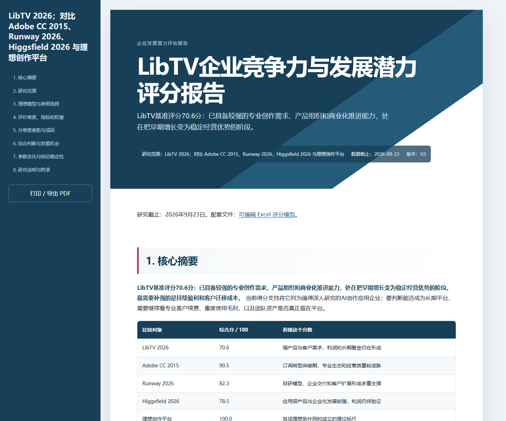
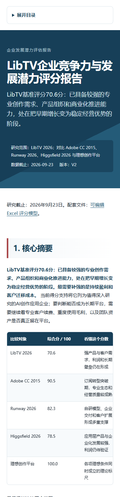
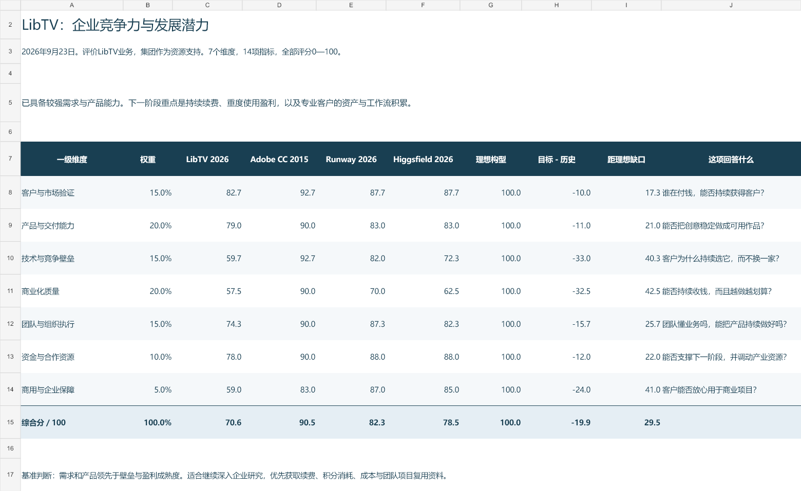

# 盒盒行业与企业发展潜力评估

> 研究行业、细分赛道或企业的发展条件，构建可比较的维度与评分模型，并用理想构型、历史高峰和现实锚点判断其发展位置、竞争力与投资吸引力。

[](LICENSE)
[](https://agentskills.io/)
[](release-manifest.json)
[](#与盒盒行业研究技能包的关系)

`hehe-development-potential-assessment` 是盒子原创的**特殊能力独立行研 Skill**。它不是通用打分表，而是一套“先研究、再建模、再比较”的发展潜力评估方法。

它会先搜索和研读目标对象、历史高峰与现实参照，提取真正影响发展的条件、限制、痛点和壁垒，再把这些内容加工成可以理解、可以比较、可以实际赋分的维度体系。最终交付完整分析报告、HTML 阅读版和可调 Excel 模型。

## 它解决什么问题

这套 Skill 适合回答：

- 一个行业当前有没有足够的生命力、竞争力或投资吸引力？
- 同一母赛道中的多个细分赛道，各自处于什么水平，应该优先关注谁？
- 一家新企业与历史高峰企业、当前领先者和理想模型相比，主要差距在哪里？
- 目标对象还缺哪些条件，哪些差距能够补齐，哪些会长期限制发展？
- 权重、评分或关键假设变化时，综合位置和排序是否稳定？

它不从固定指标库里机械抽取十几个指标，也不先造一个 Excel 再找数据填空。模型必须从本题的决策用途、比较对象、发展机制和公开材料中长出来。

## 三种分析模式

### 1. 行业发展潜力

把目标行业与理想构型、历史高峰行业及当前现实参照放在同一套维度下比较，判断它现在处于哪个发展阶段，是否仍具备足够的需求、技术、商业化、竞争和经营条件。

例如：评估 AI 教育智能硬件能否形成类似早期智能手机的行业生命力。

### 2. 细分赛道比较

为同一母赛道中的多个子赛道建立共同维度、标尺和权重，比较各自的需求强度、产品价值、商业化质量、进入条件、资源要求和限制因素。需要时按明确的组合权重汇总母赛道结果。

例如：比较教育智能硬件中的学习机、词典笔、听力设备、儿童手表和校内硬件。

### 3. 企业发展潜力

比较目标企业、历史高峰企业、当前同类企业和理想企业构型，判断目标企业的客户验证、产品交付、技术壁垒、商业化质量、组织执行、资金资源和企业保障处于什么水平。

例如：比较一家新 AI 应用企业与 Adobe 历史阶段、Runway 等现实参照的差距。

## 核心方法

```text
明确决策用途与比较层级
  → 搜索目标、历史与现实参照
  → 研读原文并解释发展机制
  → 提取候选维度与可观察指标
  → 试评并修订名称、标尺和权重
  → 用共同标准逐项评分
  → 比较分维度差距与成因
  → 检查权重、评分和关键假设的敏感性
  → 交付 Markdown、HTML 与可调 Excel
```

### 理想、历史、现实和目标四类对象

| 对象 | 作用 |
|---|---|
| 理想构型 | 定义各项关键条件同时成立时的理论标尺，并解释为什么这些条件构成理想状态 |
| 历史高峰 | 提供跨时间参考，说明某类行业或企业在高峰阶段具备哪些条件、仍有哪些短板 |
| 现实参照 | 提供当前可比对象，帮助判断目标在同一环境中的相对位置 |
| 目标对象 | 本次需要评价的行业、子赛道或企业 |

四类对象使用同一维度、指标方向、权重和评分标准。历史对象不因为年代不同就自动得高分；理想构型也不是现实中必然存在的企业。

### 维度怎样形成

维度来自研究加工。候选因素通常包括：

- 政策、监管和法律环境；
- 经济条件、预算来源和支付能力；
- 社会需求、使用习惯和任务价值；
- 技术成熟度、成本、供应和替代关系；
- 市场验证、客户结构与竞争强度；
- 盈利、现金、资本占用和规模效率；
- 组织、团队、渠道、交付和合作资源；
- 阻碍行业或企业发展的痛点、壁垒和硬约束。

最终维度只保留与本题决策有关、对象之间可以共同评价、公开材料能够支持且不会重复计算的部分。名称优先使用读者能够直接理解的行业语言。

### 怎样评分

- 指标分、维度分和综合分统一采用 0—100 分。
- 权重和对象评分都可以在 Excel 中调整。
- 定量指标说明原始值、方向、分档或换算公式。
- 定性指标拆成可观察事实，并写清评分标准、事实依据和赋分理由。
- 证据不足不会自动等于对象表现差；无法判断的项目保留空值和待补材料。
- 硬约束、敏感性和排序翻转条件与综合分一起解释。

## 搜索与研究加工

模型质量首先取决于前端研究。Skill 会围绕目标、细分对象、历史参照和现实参照进行多轮搜索：

1. **广搜全貌**：建立行业、对象、事件、指标和材料类型地图。
2. **深查机制**：追到政策原文、企业披露、统计、论文、产品材料和可信研究，理解数据背后的机制。
3. **补齐评分依据**：针对维度、标尺、对象差距和争议评分定向补搜。

搜索、研读、评分和来源索引共用一份材料台账。实际对象的评分必须能回到材料；模型知识用于提出问题和加工事实，不能代替公开证据。

## 会交付什么

实际建模默认交付：

```text
发展潜力评估项目/
├── 发展潜力评估报告.md
├── 发展潜力评估报告.html
└── 发展潜力评分模型.xlsx
```

### Markdown 主报告

报告采用摘要优先结构：

1. 核心摘要；
2. 研究范围；
3. 理想模型与参照选择；
4. 评价维度、指标和权重；
5. 分维度差距、成因与影响；
6. 综合判断与机会；
7. 参数变化与结论稳定性；
8. 研究说明与附录。

正文主要解释目标和参照之间的核心差距、形成原因及其实际含义。逐项评分材料、详细分档和来源索引放在附录或 Excel，不用赋分过程淹没分析结果。

### HTML 阅读版

HTML 与 Markdown 内容一致，使用固定离线模板：

- 桌面端提供固定章节目录；
- 手机端使用折叠目录和单列布局；
- 宽表可以横向滚动；
- CSS 和必要脚本内嵌，不依赖 CDN；
- 支持浏览器打印和导出 PDF；
- 保留 Excel 工作簿入口。





### 可调 Excel 模型

基本工作簿包括：

| 工作表 | 用途 |
|---|---|
| 模型总览 | 查看各维度权重、对象得分、综合位置和主要差距 |
| 锚点参照与赋分意义 | 比较理想、历史、现实和目标对象，说明参照选择与分差 |
| 指标详表 | 查看评分标准并调整权重、目标和参照评分 |
| 模型假设 | 查看维度选择、权重、逐项事实和赋分理由 |
| 数据溯源 | 回到原始材料、时间、对象和链接 |

复杂项目可以按需增加组合加权、计算审计和敏感性工作表。



## 安装

克隆仓库：

```bash
git clone https://github.com/hexiaofeier/hehe-development-potential-assessment.git
```

将下面的文件夹复制到客户端的 Skills 目录：

```text
skills/hehe-development-potential-assessment/
```

常见位置：

| 客户端 | 用户级 Skill 目录 | 显式调用示例 |
|---|---|---|
| Claude Code | `~/.claude/skills/` | `/hehe-development-potential-assessment` |
| Codex | `~/.codex/skills/` 或客户端配置目录 | `$hehe-development-potential-assessment` |
| 其他 Agent | 由应用配置的 Skills 目录 | 选择或点名该 Skill |

安装 Python 依赖：

```bash
python -m pip install -r skills/hehe-development-potential-assessment/requirements.txt
```

复制后新开会话，让客户端重新发现 Skill。

## 快速开始

行业比较：

```text
使用 $hehe-development-potential-assessment，
评估中国AI教育智能硬件当前的发展潜力。
建立理想构型，选择合适的历史高峰和现实参照，
研究并构建共同维度，交付Markdown、HTML和可调Excel。
```

细分赛道比较：

```text
使用 $hehe-development-potential-assessment，
比较AI教育智能硬件各细分赛道的发展潜力和投资吸引力。
说明指标选择、权重、逐项评分依据及排序翻转条件。
```

企业比较：

```text
使用 $hehe-development-potential-assessment，
比较目标AI应用企业与历史高峰企业、当前领先者和理想企业构型，
解释主要差距、追赶条件和对经营发展的含义。
```

## 随包工具

生成评分模型：

```bash
python skills/hehe-development-potential-assessment/scripts/build_scoring_workbook.py \
  --input model-input.json \
  --output 发展潜力评分模型.xlsx
```

校验评分模型：

```bash
python skills/hehe-development-potential-assessment/scripts/validate_scoring_workbook.py \
  --workbook 发展潜力评分模型.xlsx \
  --contract model-input.json
```

生成 HTML 阅读版：

```bash
python skills/hehe-development-potential-assessment/scripts/build-html-report.py \
  发展潜力评估报告.md \
  发展潜力评估报告.html \
  --report-type "行业与企业发展潜力评估报告" \
  --scope "目标与参照范围" \
  --data-cutoff "YYYY-MM-DD" \
  --version "V1.0"
```

生成器默认不覆盖已有 HTML，并检查一级标题、摘要顺序、正文一致性、目录锚点、内部链接和远程图片。

## 仓库结构

```text
hehe-development-potential-assessment/
├── README.md
├── LICENSE
├── release-manifest.json
├── docs/images/
├── scripts/validate_release.py
└── skills/
    └── hehe-development-potential-assessment/
        ├── SKILL.md
        ├── agents/openai.yaml
        ├── references/
        ├── assets/
        ├── examples/
        ├── scripts/
        ├── requirements.txt
        └── package-manifest.json
```

## 与盒盒行业研究技能包的关系

本 Skill **不属于** [`hehe-industry-research-skill-pack`](https://github.com/hexiaofeier/hehe-industry-research-skill-pack)，也不要求安装该技能包。

- 行业研究技能包负责完整行业、企业及行业＋企业研究，由总入口与13个专项组成。
- 本仓库负责一种特殊的比较建模能力：研究发展条件、建立共同维度、赋分并解释发展位置。
- 两者可以共享公开材料或互相把结果作为输入，但不存在固定调用关系。
- 本仓库复用了已经验证的 HTML 视觉系统；模板复用不构成运行和发布依赖。

## 公开边界

- 可以使用 Agent 当前拥有的网页搜索、浏览器、数据库、MCP/API 和文件解析能力，不绑定私有插件或付费工具。
- 公开材料不足时保留空值、局部评价和待补任务，不用低分冒充资料缺口。
- 综合分用于结构化比较，不替代估值、投资价格、法律意见或个性化证券建议。
- 公开仓库不包含真实项目原始材料、生成工作簿、本地维护台账、历史备份、账号和凭据。

## 发布校验

```bash
python scripts/validate_release.py
```

校验器检查公开名称、独立安装合同、必需文件、包内链接、私有路径、历史目录和生成缓存。Skill 自带的工作簿合同测试可单独运行：

```bash
python skills/hehe-development-potential-assessment/scripts/test_workbook_contract.py
```

## 许可与反馈

本项目采用 [MIT License](LICENSE)。

如发现维度不可理解、评分依据不足、Excel无法联动、HTML内容缺失或包内链接失效，请在 GitHub Issues 提供研究对象、用途、比较集合和复现步骤。
